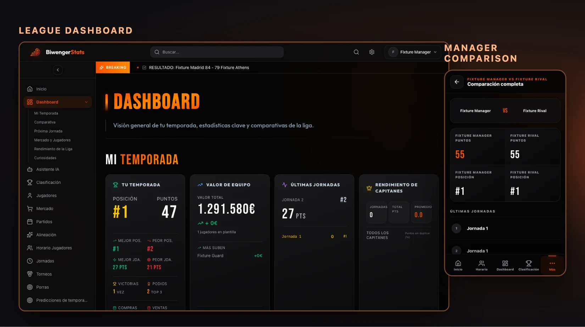

# Biwenger Stats

**See where you gained points, how your squad’s value changed, and where your rivals are pulling ahead.**

Biwenger Stats brings fantasy league history and official EuroLeague statistics together for private
Biwenger leagues.

_Screens shown with synthetic league data._ [Desktop dashboard](docs/_assets/dashboard-desktop.png) ·
[Mobile comparison](docs/_assets/compare-mobile.png)

In this example, Dani leads by 34 points. Round 3 accounts for 32 points of that gap.

## What you can do

- **Understand your season.** Track your position, recent round scores, captain performance, and
  squad value over time.
- **Compare with a rival.** See how your scores diverged and which rounds account for the gap.
- **Make a squad decision.** Check player form and market value before changing your lineup or
  placing a bid with a linked Biwenger account.

[Explore all features](docs/product/README.md)

## From league data to fantasy decisions

Scheduled jobs fetch and validate data from Biwenger and EuroLeague, then store it by season in
PostgreSQL. The Next.js app queries that history on the server to serve dashboards, comparisons, and
squad and market views.

## Explore the repository

- [How it works](docs/architecture/system-overview.md) — architecture and the path of a standings
  read and a personal bid.
- [Product map](docs/product/README.md) — features and screens by domain.
- [Local development](docs/getting-started/local-development.md) — setup, startup, and first login.
