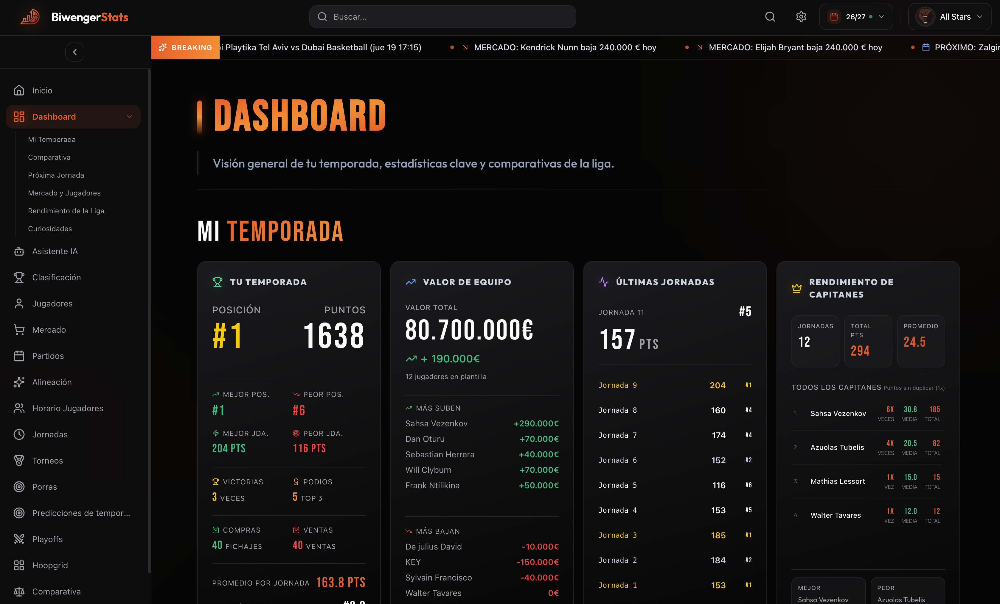
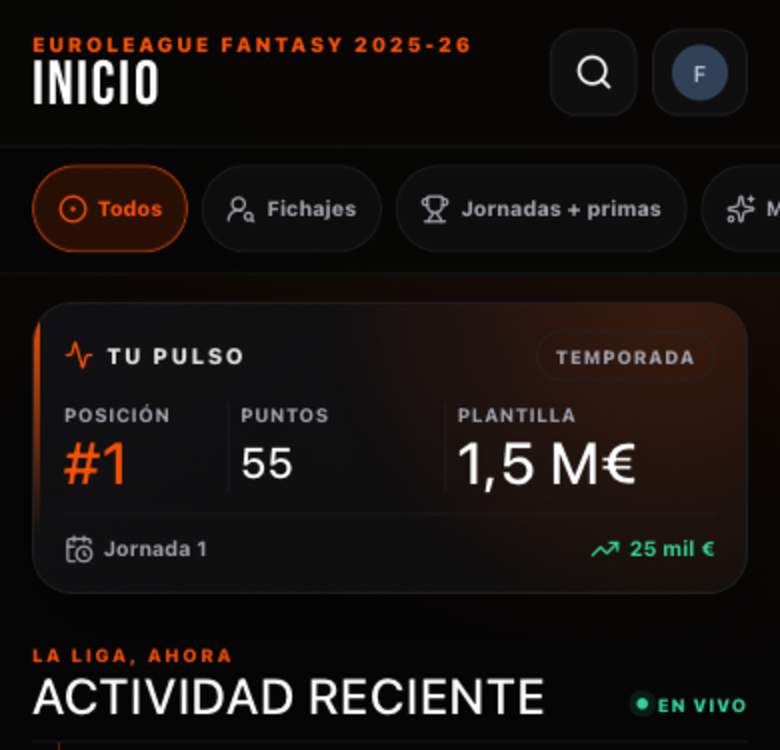
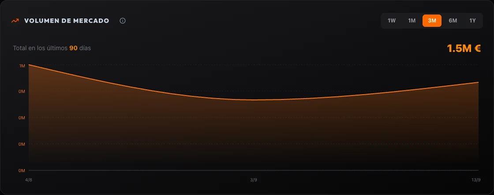
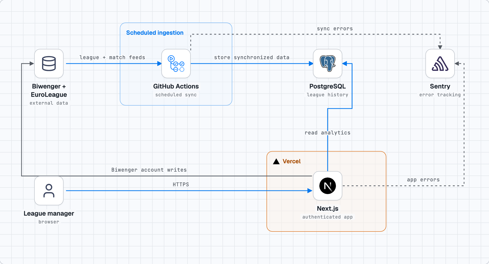

  
  <h1>Biwenger Stats</h1>
  
<strong>See where your EuroLeague fantasy season is won.</strong>

  
Follow your squad, find the rounds that put a rival ahead, and see how the market is moving. Built for private Biwenger leagues, with official EuroLeague stats and your league’s own history.

  
<a href="#product-tour">Product tour</a> · <a href="#how-the-stack-fits-together">Architecture</a> · <a href="docs/README.md">Documentation</a>

## Product tour

### Catch up on your league on mobile

Open Home to see your league position, points, squad value, and recent activity.

  

### See what the market is doing

Switch between time windows to see transfer volume. Review player values and recent activity
before making a move with a linked Biwenger account.

_The market chart uses synthetic league data._ [Explore all features](docs/product/README.md)

## How the stack fits together

<picture>
  <source media="(max-width: 650px)" srcset="docs/_assets/stack-mobile.png" />
  
</picture>

[Open full-size diagram](docs/_assets/stack.png) ·
[Read the architecture walkthrough](docs/architecture/system-overview.md)

## Explore the repository

- [Product map](docs/product/README.md) — features, screens, and their implementation.
- [Local development](docs/getting-started/local-development.md) — setup, startup, and first login.
- [Operations](docs/operations/README.md) — sync, deployment, and recovery.
- [MIT License](LICENSE)
