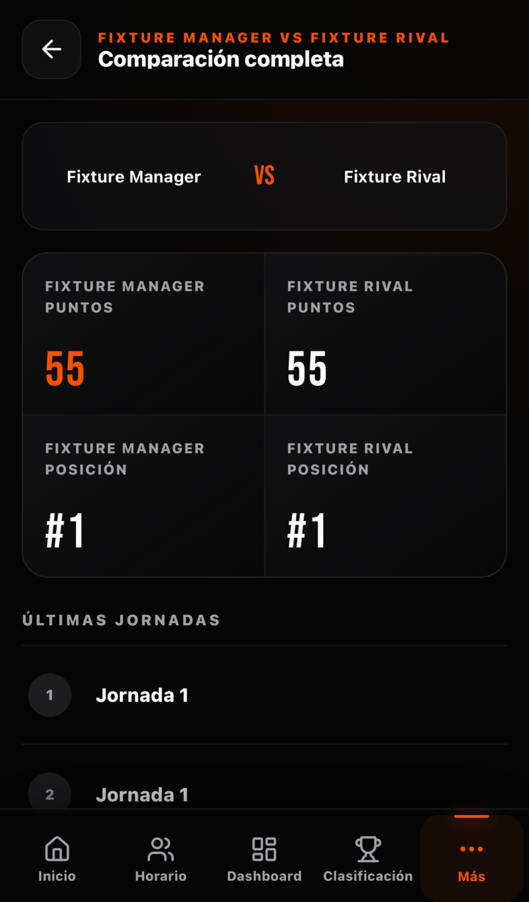

# Biwenger Stats

Biwenger Stats turns private Biwenger EuroLeague leagues into a place to follow your squad,
compare managers, and make better-informed fantasy decisions. It combines fantasy league history
with official EuroLeague results and player data.

## What you can do

- **Follow your league.** Explore standings, round results, captain performance, tournaments, and
  season trends.
- **Compare managers and players.** See where a rival gains points, browse player form and value,
  and explore official match detail.
- **Manage your squad and market.** Review ownership, transfers, and valuations. A linked personal
  Biwenger account enables supported lineup and market actions.
- **Explore beyond the standings.** Try the Hoopgrid trivia game, season predictions, and an
  optional AI assistant grounded in league data.

See the mobile manager comparison

## Stack

GitHub Actions runs scheduled ingestion. PostgreSQL holds the synchronized history, while the
Next.js app serves it through authenticated views and uses a manager's linked Biwenger account
for supported writes. The screenshots use synthetic league data.

## Explore the repository

- [How it works](docs/architecture/system-overview.md) — a five-minute walkthrough of the app
  and its data.
- [Documentation](docs/README.md) — product, architecture, operations, and contracts.
- [Local development](docs/getting-started/local-development.md) — prerequisites, database setup,
  and the first login.
- [Contributing](docs/contributing/README.md) — workflow and focused checks. Coding agents start
  with [AGENTS.md](AGENTS.md).

Report security issues privately. Keep credentials and private league data out of issues and commits.

[MIT License](LICENSE)
