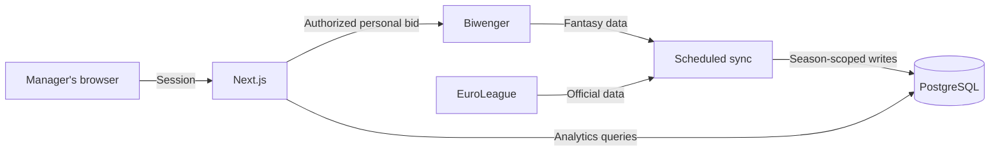

# How Biwenger Stats works

Biwenger supplies fantasy league membership, squads, points, and market activity. EuroLeague
supplies official match results, teams, players, and sporting statistics. Scheduled GitHub Actions
jobs run the sync pipeline, which validates provider responses and updates PostgreSQL for the
configured writable season. The application can use this stored history for analytics on every
request.

## From the providers to a screen

The sync pipeline reuses durable player, team, and manager identities across seasons. Ownership,
lineups, market history, and match facts carry the applicable season. The optional assistant builds
context from local league data and calls the configured AI provider.

### Read example: phone standings

The [standings page](../../src/app/%28app%29/standings/page.js) calls the
[overview service](../../src/features/standings/server/services/screens.service.ts) for the phone
view. The service combines rankings and league totals from standings services backed by
[PostgreSQL queries](../../src/features/standings/server/queries/base-standings.query.ts).
The screen receives a [typed model](../../src/features/standings/models/screens.ts) and renders it.
The desktop screen composes standings directly through the same feature.

### Write example: personal bid

The [bid handler](../../src/app/api/personal/bids/place/route.ts) requires an application session
and returns a private response. The market command validates the bid and uses the current
manager's linked Biwenger credentials to send it to Biwenger. The credentials stay server-side.
See the [personal bidding runbook](../operations/personal-bidding.md) for account requirements and
failure behavior.

## Continue reading

- [Product map](../product/README.md) for the available screens and their implementation.
- [Application layers](application-layers.md) for ownership, feature boundaries, and request flow.
- [Data and sync](data-and-sync.md) for provider ownership, locking, and season safety.
- [Authentication and security](authentication-and-security.md) for sessions and credential storage.
- [Local development](../getting-started/local-development.md) to run the app.
- [Operations](../operations/README.md) for sync, deployment, and recovery.
